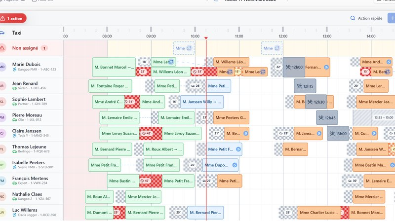
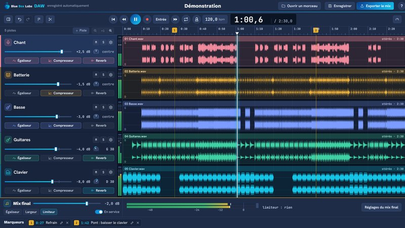

# Bastien Brasseur

Développeur logiciel indépendant · [Apptic](https://apptic.be) · Angleur (Liège)

Je conçois des logiciels métier et des applications sur mesure pour des PME, des ASBL, des CPAS et des communes. À côté, je construis mes propres outils : audio en Rust, 3D dans le navigateur, IA qui tourne en local.

## Apptic

<table>
  <tr>
    <td width="33%" valign="top">
      
       <b><a href="https://github.com/bastienbrasseur/apptic-timeshifter">Time Shifter</a></b>
       Planning partagé entre le bureau et les équipes de terrain. En production dans un CPAS wallon.
    </td>
    <td width="33%" valign="top">
      
       <b><a href="https://github.com/bastienbrasseur/apptic-ligne-43">Ligne 43</a></b>
       Simulateur de train dans le navigateur, de Liège à Esneux. <a href="https://ligne43.angleur.net">Jouable en ligne</a>.
    </td>
    <td width="33%" valign="top">
      
       <b><a href="https://github.com/bastienbrasseur/bluebox-daw-versions">Blue Box DAW</a></b>
       Logiciel de mixage multipiste, moteur audio en Rust. <a href="https://github.com/bastienbrasseur/bluebox-daw-versions/releases/latest">Téléchargeable</a>.
    </td>
  </tr>
</table>

Tous les projets professionnels : [github.com/bastienbrasseur/apptic](https://github.com/bastienbrasseur/apptic)

## Outils personnels, en open source

| Projet | Ce qu'il fait | Avec |
|---|---|---|
| [Heico](https://github.com/bastienbrasseur/heico) | Clic droit sur une image dans l'explorateur Windows, « Convertir en JPG ». HEIC d'iPhone, PNG, WebP, AVIF, par lots, sans rien envoyer en ligne. | Rust |
| [Whisper NPU Dictation](https://github.com/bastienbrasseur/whisper-npu-dictation) | Dictée vocale sous Windows : la touche enfoncée, la phrase dite, le texte arrive. Whisper tourne sur le NPU d'un processeur AMD Ryzen AI, la carte graphique reste libre. | PowerShell, Python, AutoHotkey |
| [Rocksmith DLC Manager](https://github.com/bastienbrasseur/rs-dlc-manager) | Trier, activer et désactiver les chansons de Rocksmith 2014 sans toucher aux fichiers du jeu. Outil non officiel. | Python, PySide6 |

## Contact

[apptic.be](https://apptic.be) · info@apptic.be
